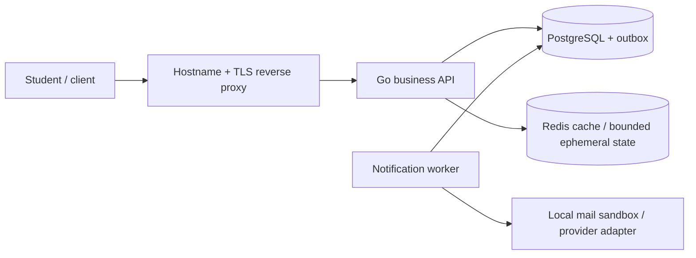

# Backend development, from your first program to a running infrastructure

An in-person, practice-first education program for people in our city who want to learn backend development with **Go (Golang)**. You can join the fundamentals course without knowing how to program. We begin with files, terminals, and a first program, then connect the language to real business rules, APIs, databases, and deployment.

The goal is to understand how a backend works as a whole and then deepen that understanding in three tiers. Students build a **local class-booking system** throughout the program: a course catalog, scheduled classes, student registration, reservations, and notifications. The same domain grows with their skills, so tools always solve a visible problem.

This repository is the teaching pack: sequenced lessons, explanations, live-demo guidance, labs, quizzes and answer keys, homework, prerequisite handoffs, capstones, and runnable beginner examples. Instruction is designed for a physical classroom with live coding, pair work, and individual checks. The city, venue, price, and enrollment dates are intentionally left to the organizer; no particular location or paid service is assumed.

## The three tiers

| Tier | Entry point | Contact time | Practical destination |
|---|---|---|---|
| [1. Fundamentals](courses/01-fundamentals/README.md) | No programming experience | **14 × 2.5 h = 35 h**, over 12 weeks (about 3 months) | Broad first exposure: Go, business entities, project structure, Git, HTTP, Docker, SQL, persistence, testing, and security awareness |
| [2. Intermediate](courses/02-intermediate/README.md) | Fundamentals exit gate or practical placement | **14 × 3 h = 42 h**, suggested 14 weeks | Deeper Go, transaction-safe booking, authentication/authorization, caching, sandbox email, containers, testing, CI, and observability |
| [3. Advanced](courses/03-advanced/README.md) | Intermediate exit gate | **14 × 3 h = 42 h**, suggested 14 weeks | Operate a small multi-service infrastructure: business API, notification worker, database, Redis, email/OTP, DNS, TLS, Kubernetes, delivery, backups, and recovery |

**Coverage language:** fundamentals targets the first **20%** of this program’s competency journey; intermediate adds the next **30 percentage points**, reaching **50%** cumulatively. These are planning labels for breadth and depth, not measurable percentages of all backend knowledge. Advanced completes this program’s defined outcomes, not “100% of backend.” [The competency map](resources/competency-map.md) makes the actual expectations explicit.

35 contact hours can introduce the whole picture; it cannot make a first-time programmer independently production-ready. Fundamentals includes **2–4 hours of home practice per lesson** (28–56 hours in addition to class). Later tiers expect **4–6 hours per lesson**. Offer a supported setup clinic and a weekly optional practice clinic, outside contact-hour totals. Rebaseline pacing when exit checks show learners need more time.

## Start teaching tomorrow

1. Follow the [first-class instructor checklist and script](instructor/start-tomorrow.md).
2. Send students the [setup guide](resources/setup.md); only Go and an editor are required at first. Arrange paired or instructor machines for incomplete installations.
3. Open [Fundamentals lesson 01](courses/01-fundamentals/01-backend-and-first-program/README.md), its teaching notes, lab, and quiz.
4. Rehearse the first program:

   ```sh
   cd examples/01-hello
   go run .
   ```

5. End class with the lesson’s exit check and [home practice / next-class preparation](courses/01-fundamentals/01-backend-and-first-program/HOMEWORK.md).

The next class is always prepared by the previous class’s homework: install Git before lesson 06, verify curl before 07, install Docker before 09, verify PostgreSQL before 10, and download the database driver before 11. Never spend the first lesson installing Kubernetes.

## How each lesson works

Each of the **42 lesson directories** contains:

- `README.md`: outcomes, prerequisites, timed agenda, and student explanations.
- `TEACHING.md`: instructor demonstration, concept explanations, expected reasoning, and support guidance.
- `LAB.md`: steps, acceptance checks, and an evidence worksheet.
- `QUIZ.md`: three questions, scoring, and a collapsible instructor answer key.
- `HOMEWORK.md`: required practice, submission criteria, and preparation for the next lesson.

Students predict, observe, explain, and then change the example independently. Homework includes a reproducible artifact and a reflection on help received. The [assessment guide](instructor/assessment.md) defines corrections, placement, rubrics, and mandatory gates. The [schedule](instructor/schedule.md) fits fundamentals into 12 weeks without hiding extra teaching hours.

## The project grows with the learner

| Stage | What students build | Deliberate boundary |
|---|---|---|
| Fundamentals | CLI booking rules; session catalog; persistent student registration API; SQL schema and basic tests | Local synthetic data; no public authentication claim; in-memory demo bookings reset on restart |
| Intermediate | One business API with authenticated ownership checks, transactional persistent bookings, cache, email adapter, and a local container stack | In-memory notification work is explicitly not durable; the advanced tier closes that gap |
| Advanced | Business API and separate notification worker, transactional outbox, OTP controls, verified HTTPS, versioned releases, Kubernetes stateless workloads, and restored backups | Small training infrastructure; no claim of multi-region availability or exhaustive production hardening |



In advanced, deploy API and worker as separate workloads. Keep stateful-service placement explicit: a disposable local database is fine for practice; a real deployment needs a reviewed storage, access, backup, and recovery plan.

## Repository guide

```text
courses/
  01-fundamentals/       14 lessons + capstone
  02-intermediate/       14 lessons + capstone
  03-advanced/           14 lessons + capstone
instructor/             first-day script, schedule, assessments, validation record
resources/              setup, glossary, references, designs, operational worksheets
examples/               greeting, CLI, HTTP API, SQL, database API
infrastructure/         local PostgreSQL/Redis/Mailpit, TLS and Kubernetes lab templates
scripts/                example checks and curriculum link/structure checks
```

Start with the [example index](examples/README.md). Infrastructure templates support the lessons; they are not a completed advanced application. Later-tier implementation labs extend the learner’s capstone and include acceptance criteria instead of handing out a full solution. Review the [validation record](instructor/validation.md) before using any environment-dependent demo.

## Course direction and references

The [backend and Go roadmaps, plus official topic references](resources/sources.md), inform topic sequencing. This is an original teaching sequence with bounded outcomes, not a promise to cover every roadmap node. Instructors should recheck installer instructions and security guidance before each cohort, rehearse the demos, and record the versions actually used.

Optional follow-on topics include gRPC, message brokers, search engines, object storage, GraphQL, deep profiling, distributed consensus, multi-region design, and advanced PostgreSQL administration. They are intentionally outside the mandatory 119 contact hours.
